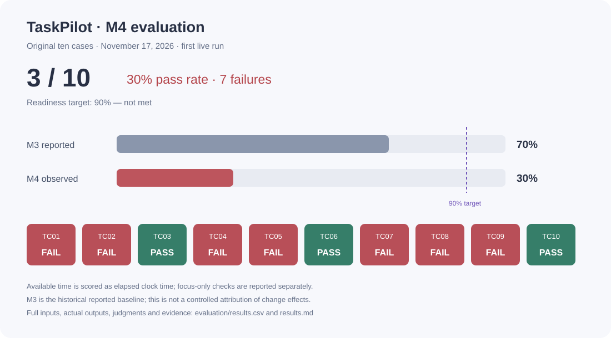

# M4: original ten-case evaluation — first live run

**Result: 3/10 passed (30%). Seven failures.** The committed readiness threshold is 9/10. It was not met.

Run date: November 17, 2026. Model: gpt-oss; reasoning effort: low. Two agents with real NRP inference and MCP retrieval. Cases used the uncommitted refined application identified by the source hashes in the [manifest](evidence/m4_2026-11-17_run1/manifest.json).

## Method and scoring

- Test inputs and criteria come from submitted M3 Section 4.3. This is an executed evaluation, separate from local regression tests.
- The fixed as-of date is October 27, 2026. Original files were recovered from Git 30461f1. Older work was explicitly marked complete, matching M3’s past-work assumption. The December demo data was not substituted.
- Current fictional calendar events were retained because they are part of the current application. This and the controlled date/explicit completion flags are disclosed adaptations. Case 10 uses a missing path instead of renaming the project folder.
- Each case was run once; TC08 includes a real initial turn plus follow-up. Two independent requests ran concurrently. No selective reruns or application fixes were performed during the run.
- PASS means all stated primary criteria were met. A clean process exit or correct focus-time sum alone does not establish success. A stated available hour means an hour of elapsed availability; extra breaks or gaps require confirmation. TC02 and TC08 meet a narrower focus-minutes-only check, but fail the original availability interpretation and contain misleading timing/context claims.
- Handoff and zero-availability cases are scored on their defined criteria; secondary problems are still recorded. TC10 is an expected local guard response, not an AI inference success.
- Assessment is manual review by the coding assistant, not an independent student/critic-agent rating. No numerical critic scores were invented. The finite time-range guard does not validate every factual claim in AI prose.

## Case chart

| Case | Test | Outcome | Observed result |
|---|---|---|---|
| TC01 | Normal schedule | **FAIL** | 240 focus minutes are placed from Oct 27 20:15 to Oct 28 18:35 (1,340 elapsed minutes). The model adds an unrequested after-last-event constraint and moves work into tomorrow; the prose also misdescribes the M3 blocks. |
| TC02 | Limited availability | **FAIL** | 60 focus minutes require a 70-minute clock window (10:30–11:40) because of a break. The answer calls this a one-hour window and incorrectly says it is the only free slot today. Remaining workload is present in the JSON but not explained in the answer. |
| TC03 | Zero availability | **PASS** | No plan or work blocks are produced. The answer acknowledges zero time today and asks whether another day should be considered. |
| TC04 | Missing availability | **FAIL** | No clarification reaches the user. The worker returns an intent-validation error: AI attempted to schedule without availability; CLI exits 1. |
| TC05 | Conflicting deadlines | **FAIL** | The AI restricts planning to the three-hour task, drops the eight-hour task, and reports no unfinished work. Its 180 focus minutes extend into Oct 28. The answer never recognizes the 11-hour total or explains the shortage. |
| TC06 | Agent handoff | **PASS** | Instrumented evidence records one MCP tool result, handoff=true, and advisor_returned=true. The JSON includes interpreted request context and source snapshot. A single final AI answer is returned. |
| TC07 | Knowledge retrieval | **FAIL** | The source snapshot contains the new poster record with correct fields, but the AI answers with a study plan for Trees and heaps and never mentions the poster or provides the requested upcoming-assignment overview. |
| TC08 | Changed availability | **FAIL** | The follow-up preserves context and changes the focus budget to 120 minutes, but the resulting plan runs 17:15–20:55 (220 elapsed minutes). It also carries forward an after-work restriction invented in the initial turn. Unfinished work is present in JSON. |
| TC09 | Insufficient time | **FAIL** | The answer correctly says one hour is insufficient, but provides no plan and no numeric remaining-work calculation. It asks which task feels urgent and drops the explicit hour from structured context. |
| TC10 | Missing syllabus data | **PASS** | The CLI reports that no .txt syllabus files exist at the controlled missing path and exits cleanly with expected code 2, without an AI call or invented plan. |

## Inputs, actual responses, and failure analysis

### TC01 — Normal schedule — FAIL

**Input/setup:** I have 4 hours to study today. What should I work on?

**Expected:** Prioritize upcoming work; stay within the four hours available today (240 minutes); accurately describe unfinished work.

**Actual AI answer or error:**

> Your first study slot starts today at 8:15 PM (America/New_York) with the Trees and heaps quiz preparation. The plan fits four hours of focused work around your existing events, ending with a short block on the multi‑agent system analysis later tonight and tomorrow morning.

**Observed output:** 240 focus minutes are placed from Oct 27 20:15 to Oct 28 18:35 (1,340 elapsed minutes). The model adds an unrequested after-last-event constraint and moves work into tomorrow; the prose also misdescribes the M3 blocks.

**Root cause:** Reasoning and calendar scheduling. Today/availability constraints are not enforced end to end; the calendar scheduler searches subsequent days and the narrator does not accurately explain the result.

**Capture time:** 19.811 s; focus minutes: 240; elapsed calendar span: 1340 minutes.

[Full raw output and command](evidence/m4_2026-11-17_run1/TC01.json)

### TC02 — Limited availability — FAIL

**Input/setup:** I only have 1 hour available today.

**Expected:** Schedule no more than 60 minutes within the stated available hour and acknowledge unfinished work.

**Actual AI answer or error:**

> Your only free slot today starts at 10:30 AM (after your morning class) and runs until about 11:40 AM. Use the first 50 minutes for the Trees and heaps quiz preparation (due Oct 28) and the remaining 10 minutes to continue the same task. This fits your 1‑hour window and makes progress on the nearest deadline.
> Would you like to keep this timing or adjust the start time?

**Observed output:** 60 focus minutes require a 70-minute clock window (10:30–11:40) because of a break. The answer calls this a one-hour window and incorrectly says it is the only free slot today. Remaining workload is present in the JSON but not explained in the answer.

**Root cause:** Scheduling and answer grounding. The implementation treats availability as focus time without obtaining agreement for extra break/gap time; prose adds an unsupported availability claim.

**Capture time:** 21.701 s; focus minutes: 60; elapsed calendar span: 70 minutes.

[Full raw output and command](evidence/m4_2026-11-17_run1/TC02.json)

### TC03 — Zero availability — PASS

**Input/setup:** I have 0 hours available today.

**Expected:** Assign no study or preparation work today.

**Actual AI answer or error:**

> Got it—you don’t have any study time free today. Is there another day you’d like to look at for fitting in work on the upcoming Trees and heaps quiz prep (due Oct 28) or the M3 multi‑agent system task (also due Oct 28)?

**Observed output:** No plan or work blocks are produced. The answer acknowledges zero time today and asks whether another day should be considered.

**Root cause:** None for the defined criterion. The context loses the numeric zero (minutes becomes null), but no work is assigned; that secondary limitation does not fail the original zero-work criterion.

**Capture time:** 11.038 s.

[Full raw output and command](evidence/m4_2026-11-17_run1/TC03.json)

### TC04 — Missing availability — FAIL

**Input/setup:** Help me plan my assignments.

**Expected:** Ask for available hours without assuming a budget or producing a concrete schedule.

**Actual AI answer or error:**

> The model response did not pass the required data/format checks. AI attempted to schedule without availability. Stage: intent validation; error: ValueError

**Observed output:** No clarification reaches the user. The worker returns an intent-validation error: AI attempted to schedule without availability; CLI exits 1.

**Root cause:** Reasoning and input handling. The guard correctly prevents an unsafe schedule, but the system fails to return the required clarifying question.

**Capture time:** 10.198 s.

[Full raw output and command](evidence/m4_2026-11-17_run1/TC04.json)

### TC05 — Conflicting deadlines — FAIL

**Input/setup:** SETUP: Two assignments due 2026-10-28, requiring 3 and 8 hours. I have 3 hours today, and multiple assignments are due soon. How should I prioritize?

**Expected:** Two tasks due Oct 28 require 3 and 8 hours: recognize 11 total hours, explain prioritization, stay within 180 available minutes today, and flag work at risk of lateness.

**Actual AI answer or error:**

> Your three‑hour assignment for Conflict Test is due tomorrow, so it makes sense to use today’s free slots. The first study block can begin at 5:15 PM after your work shift, with short breaks before the next windows at 6:15‑6:45 PM and 8:15‑9:05 PM. This fits the full 180 minutes you have available and keeps you on track for the October 28 deadline.
> Does starting at 5:15 PM work for you, or would you prefer a different time?

**Observed output:** The AI restricts planning to the three-hour task, drops the eight-hour task, and reports no unfinished work. Its 180 focus minutes extend into Oct 28. The answer never recognizes the 11-hour total or explains the shortage.

**Root cause:** Reasoning, task scope, and scheduling. An invented scope restriction hides eight hours of work; remaining-work accounting is correct only for the wrongly narrowed scope.

**Capture time:** 9.725 s; focus minutes: 180; elapsed calendar span: 890 minutes.

[Full raw output and command](evidence/m4_2026-11-17_run1/TC05.json)

### TC06 — Agent handoff — PASS

**Input/setup:** I have 2 hours today. Check my upcoming assignments and make a study plan.

**Expected:** Execute a source tool call/result, one handoff containing the request and analyst findings, and one final advisor response.

**Actual AI answer or error:**

> Your first study block can start at 10:30 AM today, focusing on the Trees and heaps quiz preparation for COT 3400. You’ll have a 50‑minute session, a short 10‑minute break, then another 15‑minute slot, followed by an evening block of 50 minutes after work. This fits your two‑hour window around existing commitments.
> Does the 10:30 AM start work for you, or would you prefer a different time?

**Observed output:** Instrumented evidence records one MCP tool result, handoff=true, and advisor_returned=true. The JSON includes interpreted request context and source snapshot. A single final AI answer is returned.

**Root cause:** None for the defined handoff criterion. This is a handoff pass only. The answer describes 115 of the 120 focus minutes and misleadingly calls separated blocks a two-hour window. Full internal messages are not exported; handoff evidence is instrumentation plus the hashed implementation.

**Capture time:** 8.655 s; focus minutes: 120; elapsed calendar span: 470 minutes.

[Full raw output and command](evidence/m4_2026-11-17_run1/TC06.json)

### TC07 — Knowledge retrieval — FAIL

**Input/setup:** SETUP: Original source plus Prepare TaskPilot poster, due 2026-11-15, 2 hours. I have 2 hours today. What upcoming assignments do I have?

**Expected:** Add Prepare TaskPilot poster, due 2026-11-15, estimated 2 hours; retrieve correct course/date/hours/source and preserve those details in the analysis/answer.

**Actual AI answer or error:**

> You have a 2‑hour window today for the "Trees and heaps quiz preparation" (COT 3400) due Oct 28. Your first study block can start at 10:30 AM, then a short break, another block at 11:30 AM, and a final block after work at 5:15 PM. This uses the full 120 minutes you have available. The rest of your assignments remain on the list for later sessions.
> Would you like to adjust any of these start times?

**Observed output:** The source snapshot contains the new poster record with correct fields, but the AI answers with a study plan for Trees and heaps and never mentions the poster or provides the requested upcoming-assignment overview.

**Root cause:** Intent interpretation and response grounding. File retrieval works at the data level; the agent selects the wrong response action and fails to surface the retrieved record.

**Capture time:** 9.895 s; focus minutes: 120; elapsed calendar span: 470 minutes.

[Full raw output and command](evidence/m4_2026-11-17_run1/TC07.json)

### TC08 — Changed availability — FAIL

**Input/setup:** PRIOR TURN: I have 4 hours to study today. What should I work on?
FOLLOW-UP: I now only have 2 hours instead of 4. Please plan using my new availability.

**Expected:** After an actual four-hour interaction, use the new 120-minute availability, identify unfinished work, and provide a plan fitting that availability.

**Actual AI answer or error:**

> Your first study block starts today at 5:15 PM (America/New_York) and covers Trees and heaps quiz preparation for COT 3400. It runs for 50 minutes, then a 10‑minute break, another 30‑minute block, another break, and a final 40‑minute block, totaling the 2 hours you have left.
> Does that start time work for you?

**Observed output:** The follow-up preserves context and changes the focus budget to 120 minutes, but the resulting plan runs 17:15–20:55 (220 elapsed minutes). It also carries forward an after-work restriction invented in the initial turn. Unfinished work is present in JSON.

**Root cause:** Scheduling and conversational constraint handling. The numeric update works, but available clock time is confused with focus time and an unsupported constraint persists. The initial four-hour response also incorrectly claims it finishes by 22:00 despite blocks tomorrow.

**Capture time:** 29.675 s; focus minutes: 120; elapsed calendar span: 220 minutes.

[Full raw output and command](evidence/m4_2026-11-17_run1/TC08.json)

### TC09 — Insufficient time — FAIL

**Input/setup:** I have 1 hour today. Can I finish all my upcoming assignments?

**Expected:** Explain the shortage, propose no more than 60 minutes of work, and calculate remaining work correctly.

**Actual AI answer or error:**

> You have about an hour free now, but the upcoming tasks together require many more hours, so you won’t be able to finish all of them today.
> Which assignment feels most urgent for you right now?

**Observed output:** The answer correctly says one hour is insufficient, but provides no plan and no numeric remaining-work calculation. It asks which task feels urgent and drops the explicit hour from structured context.

**Root cause:** Reasoning and incomplete answer. The general shortage is recognized, but the required remaining-work estimate (62 hours after one hour against a 63-hour source workload) is not produced.

**Capture time:** 11.598 s.

[Full raw output and command](evidence/m4_2026-11-17_run1/TC09.json)

### TC10 — Missing syllabus data — PASS

**Input/setup:** SETUP: Nonexistent syllabus folder. I have 3 hours today. What assignments should I work on?

**Expected:** Report unavailable data without inventing assignments or an unhandled crash.

**Actual AI answer or error:**

> Cannot start TaskPilot: No .txt syllabus files found in /Users/jacob_schmidt/Desktop/TeamProject5_M2-main/evaluation/evidence/m4_2026-11-17_run1/missing_syllabi.

**Observed output:** The CLI reports that no .txt syllabus files exist at the controlled missing path and exits cleanly with expected code 2, without an AI call or invented plan.

**Root cause:** None for the defined missing-data criterion. This is a local input-guard pass, not evidence of a successful two-agent inference.

**Capture time:** 0.06 s.

[Full raw output and command](evidence/m4_2026-11-17_run1/TC10.json)

## Performance and baseline context

10 AI turns were attempted (TC08 has two turns). 9 returned a completed AI reply; 9 successful turns finished within 60 seconds. All attempts returned within 60 seconds, including the failed intent-validation request; fast failure is not counted as a usable answer. TC10 exited locally without an AI call.

M3 reported 7/10 (70%), with handoff evidence reused from its retrieval test and acknowledged errors outside individual case criteria. This run is 3/10 (30%), an observed difference of **−40 percentage points**. It is not a controlled causal estimate: the calendar workflow, clock assumptions, instrumented outputs and application implementation differ. Individual change impacts were not isolated or measured.

## What needs attention before claiming readiness

1. Treat a student’s stated available time as an elapsed-time constraint, including breaks and calendar gaps, or ask permission to split it. Enforce “today.”
2. Preserve explicit availability and avoid inventing after-work/end-of-day restrictions.
3. Prevent task filters from hiding other workload, especially shared deadlines; show correct totals and remaining work.
4. Return a clarification when availability is missing, and answer assignment-list queries with retrieved facts.
5. Check prose against the whole verified plan: dates, block counts/durations, windows, and workload claims.

These are findings, not fixes performed during the evaluation. Keep this run as the baseline for a separately labeled rerun after changes.
