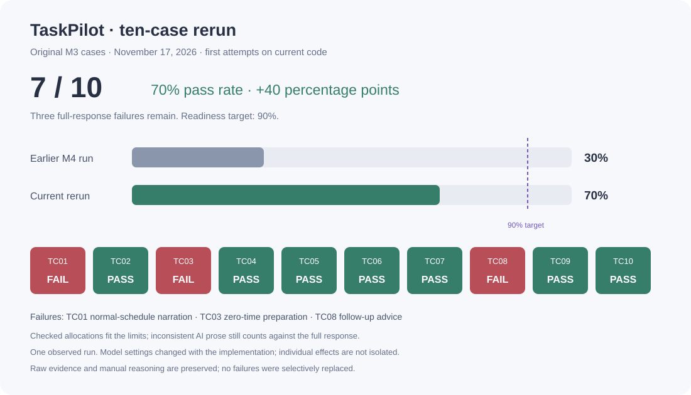

# Original ten-case evaluation — second live run

**7/10 passed (70%).** Previous recorded run: 3/10 (30%). Combined change: **+40 percentage points**. Readiness target: 9/10; **not met**.

The checked scheduling data now fits its budgets and deadlines. Three full-response failures remain: normal-schedule narration, zero-time preparation advice, and contradictory changed-availability advice.

## Ten-case chart

| Case | Test | Previous | Rerun | Observed result |
|---|---|---|---|---|
| TC01 | Normal schedule | FAIL | **FAIL** | The checked schedule is 65 focus + 10 break = 75 elapsed minutes today, within 240. The AI incorrectly calls the 10:30–11:20 block a 65-minute focused slot and then adds the separate 15-minute block, contradicting its displayed allocation and remaining-work accounting. |
| TC02 | Limited availability | FAIL | **PASS** | Schedules 50 minutes from 10:30 to 11:20, leaves 10 minutes unallocated and explicitly reports 62h 10m still unfinished. The allocation stays inside the available hour. |
| TC03 | Zero availability | PASS | **FAIL** | The checked schedule correctly has zero blocks, but the AI's first concrete step assigns a 15–20-minute topic-review/material-gathering block despite zero availability. |
| TC04 | Missing availability | FAIL | **PASS** | Asks for available hours/minutes; minutes remains null and no concrete schedule is produced. |
| TC05 | Conflicting deadlines | FAIL | **PASS** | Keeps both same-deadline tasks in analysis, computes 11 total hours, prioritizes the shorter task, schedules 65 focus minutes in a 75-minute window, reports 9h 55m remaining and visibly flags both tasks at risk. |
| TC06 | Agent handoff | PASS | **PASS** | Records a real MCP tool result, a handoff containing request/analysis context, and one returned advisor response. |
| TC07 | Knowledge retrieval | FAIL | **PASS** | Retrieves and surfaces the added poster in the complete 14-item inventory. The source snapshot retains its correct task, course, November 15 date, 2-hour estimate and software_engineering.txt source. |
| TC08 | Changed availability | FAIL | **FAIL** | The real follow-up retains context, changes 240 to 120 minutes and displays a correct 75-minute plan with 61h 55m unfinished. Its prose also instructs 15 minutes of immediate preparation plus a short break, proposes an extra 35-minute evening block, and falsely claims there is only one remaining free window. |
| TC09 | Insufficient time | FAIL | **PASS** | Schedules 50 minutes within the available hour and reports a correctly computed 62h 10m of work remaining, plus a deadline-capacity shortage warning. |
| TC10 | Missing syllabus data | PASS | **PASS** | Reports the missing syllabus folder with expected exit code 2, without an AI call, invented assignments or unhandled traceback. |

## Method and scoring

- All ten original M3 cases executed once; TC08 includes a real initial four-hour turn and follow-up. No selective reruns or application changes occurred during this evaluation.
- Same original fixture hashes, controlled October 27, 2026 planning date, explicit completion of older work, and fictional 09:30 Eastern calendar as the recorded 3/10 run. The December interview data was not substituted.
- Cases 5/7 use their original special fixtures; case 10 uses a nonexistent folder instead of renaming user data. These calendar/date/file-path adaptations are inherited and disclosed.
- Original success criteria were cross-checked against submitted M3 Section 4.3, pages 6–8. Checked allocations and the whole delivered response were reviewed separately. Correct JSON or a zero exit code is not by itself a case pass.
- Narrow retrieval/handoff criteria can pass despite secondary prose issues; these are explicitly recorded. Retrieval analysis includes the retrieved snapshot and computed analysis facts; the report does not claim that every source field appears in the final prose.
- Reviewer: coding assistant, not an independent user or critic rating. No critic scores were invented. Tool/handoff counts are instrumented evidence, not a complete SDK-native handoff trace.
- Model: gpt-oss. Analyst reasoning: low. Current plan/clarification advisor reasoning: medium; inventory path: low. The first run used low effort throughout. This comparison covers the combined current implementation/settings and does not isolate any individual change.
- The historical M3 PDF reported 7/10 with different execution limitations; that is not a controlled baseline. The directly preserved earlier M4 run is 3/10.
- The original report, CSV, chart and raw evidence remain unchanged. These rerun artifacts use separate filenames.

[Full input/expected/actual CSV](results_run2.csv) · [Source manifest](evidence/m4_2026-11-17_run2/manifest.json) · [Recorded review](evidence/m4_2026-11-17_run2/review.json) · [Earlier 3/10 report](results.md)

## Allocation checks and response time

All 10 actual AI turns returned responses; no provider/validation timeout occurred. Each finished within 60 seconds (mean 15.2s, range 10.5–25.8s). TC08 takes 42.0s for both turns combined. TC10 returned the expected local error without AI.

Every returned plan passed focus-sum, elapsed-budget, same-day, deadline and remaining-work arithmetic checks. TC03 has an empty zero-minute plan; TC04/TC07 have no plan. This does **not** validate the AI narration or any extra work it suggests outside the checked blocks.

## Actual outputs and analysis

### TC01 — Normal schedule — FAIL

**Input/setup:** I have 4 hours to study today. What should I work on?

**Expected:** Prioritize upcoming work; stay within the four hours available today (240 minutes); accurately describe unfinished work.

**Actual reply/error:**

> Your schedule today already reserves a 65‑minute focused slot for **Trees and heaps quiz preparation** (10:30 – 11:20) plus a short 15‑minute follow‑up (11:30 – 11:45). That covers about 75 minutes of study time including breaks, leaving roughly 165 minutes of your 4‑hour window still open.
>
> The calendar shows another free stretch from **17:15 to 18:45**. You could slot another block for the same quiz prep there – for example, a 60‑minute focused session with a 5‑minute break. That would bring the total focused work on the quiz to about 2 hours, still well within its 3‑hour estimate and well before the due date (Oct 28).
>
> **First concrete step:** open your algorithms notes (or the quiz review sheet) and spend the next 10‑15 minutes reviewing the tree concepts you find trickiest. That quick warm‑up will make the later longer block flow more smoothly.
>
> **Question:** does the 17:15 – 18:45 window work for you to add another quiz‑prep block, or would you prefer to use that time for a different assignment?
>
> Study schedule (America/New_York):
>   Tue, Oct 27 2026 · 10:30 AM–11:20 AM | Trees and heaps quiz preparation (50 minutes); due 2026-10-28
>   11:20 AM–11:30 AM | Break (10 minutes)
>   Tue, Oct 27 2026 · 11:30 AM–11:45 AM | Trees and heaps quiz preparation (15 minutes); due 2026-10-28
> Study time: 1 hour 15 minutes including breaks, of 4 hours available. Unallocated: 2 hours 45 minutes.
> Estimated work remaining after this proposed session: 61 hours 55 minutes.
> Deadline risk: Trees and heaps quiz preparation, M3 multi-agent system and cost analysis — the known free time cannot cover the estimated work before the listed deadline. Confirm date-only cutoff times.

**Judgment:** The checked schedule is 65 focus + 10 break = 75 elapsed minutes today, within 240. The AI incorrectly calls the 10:30–11:20 block a 65-minute focused slot and then adds the separate 15-minute block, contradicting its displayed allocation and remaining-work accounting.

**Reason:** The table and Python remaining estimate (61h 55m) are correct, but the AI's description counts the first 50-minute block as 65 and then counts the second 15 minutes again. The combined answer is not an internally consistent allocation/remaining-work explanation. No invented timing constraint or next-day allocation remains in the checked plan.

**Secondary notes:** Another evening window is offered conditionally, not saved or included in the checked schedule.

**Checked allocation:** PASS; focused work: 65; allocated elapsed study time: 75; clock span: 75 minutes.

[Full raw command/output](evidence/m4_2026-11-17_run2/TC01.json)

### TC02 — Limited availability — PASS

**Input/setup:** I only have 1 hour available today.

**Expected:** Schedule no more than 60 minutes within the stated available hour and acknowledge unfinished work.

**Actual reply/error:**

> You have a 50‑minute block set for ‘Trees and heaps quiz preparation’ from 10:30 am to 11:20 am. The quiz is due tomorrow (Oct 28), so it’s a good target to hit now. The plan uses 50 minutes of focused work and leaves 10 minutes of your hour unused – you could use that for a quick recap or a short break before moving on.
>
> A concrete first step is to open your ‘algorithms.txt’ notes, skim the tree‑balance properties, and then solve one practice problem on heap insertion. That will get you into the material and give a sense of progress.
>
> If you’d like to keep the momentum, there’s an open slot later today from 5:15 pm to 6:45 pm (90 minutes). We could schedule additional quiz prep or start on the ‘M3 multi‑agent system and cost analysis’ assignment there.
>
> Would you like to plan some work for that afternoon window as well?
>
> Study schedule (America/New_York):
>   Tue, Oct 27 2026 · 10:30 AM–11:20 AM | Trees and heaps quiz preparation (50 minutes); due 2026-10-28
> Study time: 50 minutes including breaks, of 1 hour available. Unallocated: 10 minutes.
> Estimated work remaining after this proposed session: 62 hours 10 minutes.
> Deadline risk: Trees and heaps quiz preparation, M3 multi-agent system and cost analysis — the known free time cannot cover the estimated work before the listed deadline. Confirm date-only cutoff times.

**Judgment:** Schedules 50 minutes from 10:30 to 11:20, leaves 10 minutes unallocated and explicitly reports 62h 10m still unfinished. The allocation stays inside the available hour.

**Reason:** The 63-hour source workload minus 50 proposed focus minutes equals 62h 10m. Optional extra-session suggestions are framed as questions and not included in this hour's allocation.

**Secondary notes:** The agent describes algorithms.txt as notes, although it is a syllabus source. No source evidence establishes the suggested lecture-note content.

**Checked allocation:** PASS; focused work: 50; allocated elapsed study time: 50; clock span: 50 minutes.

[Full raw command/output](evidence/m4_2026-11-17_run2/TC02.json)

### TC03 — Zero availability — FAIL

**Input/setup:** I have 0 hours available today.

**Expected:** Assign no study or preparation work today.

**Actual reply/error:**

> Your current plan shows no available minutes today, so nothing can be scheduled right now. All three upcoming assignments are still unfinished, with the quiz preparation for **Trees and heaps** due tomorrow (Oct 28) requiring the most urgent attention.
>
> **Recommended target:** focus on *Trees and heaps quiz preparation* as your next study goal because it’s due the soonest.
>
> **First concrete step:** spend a short, manageable block (e.g., 15‑20 minutes) reviewing the list of quiz topics and gathering any lecture slides or notes you’ll need. This lets you jump straight into studying when you find a free slot.
>
> **Next step for you:** could you let me know when you expect to have some time available (later today, tomorrow, or another day) so we can fit a short study block for the quiz prep into your schedule?
>
> Study schedule (America/New_York):
> No blocks scheduled.
> Study time: 0 minutes including breaks, of 0 minutes available. Unallocated: 0 minutes.
> Estimated work remaining after this proposed session: 63 hours.
> Deadline risk: Trees and heaps quiz preparation, M3 multi-agent system and cost analysis — the known free time cannot cover the estimated work before the listed deadline. Confirm date-only cutoff times.

**Judgment:** The checked schedule correctly has zero blocks, but the AI's first concrete step assigns a 15–20-minute topic-review/material-gathering block despite zero availability.

**Reason:** M3 explicitly requires no study OR preparation work today. The reply acknowledges no free time, then tells the user to spend 15–20 minutes preparing so they can study when a free slot appears. The preparation instruction is not explicitly deferred to an agreed future day. This is a regression from the first run, where the reply only asked about future availability.

**Secondary notes:** The prose also says all three assignments are unfinished; the snapshot actually contains thirteen active assignments. The displayed zero allocation and 63-hour remaining total are correct.

**Checked allocation:** PASS; focused work: 0; allocated elapsed study time: 0; clock span: 0 minutes.

[Full raw command/output](evidence/m4_2026-11-17_run2/TC03.json)

### TC04 — Missing availability — PASS

**Input/setup:** Help me plan my assignments.

**Expected:** Ask for available hours without assuming a budget or producing a concrete schedule.

**Actual reply/error:**

> Hey, to pick the best assignment I need to know how much study time you have free. Could you let me know the total minutes (or hours) you can dedicate today or over the next day?
>
> How much study time do you have available?

**Judgment:** Asks for available hours/minutes; minutes remains null and no concrete schedule is produced.

**Reason:** The request reaches the advisor and returns a focused availability clarification instead of an intent-validation error or guessed duration.

**Secondary notes:** The availability question is repeated in follow_up. This is conversational friction, not a failure of the original criterion.

**Checked allocation:** N/A; focused work: None; allocated elapsed study time: None; clock span: 0 minutes.

[Full raw command/output](evidence/m4_2026-11-17_run2/TC04.json)

### TC05 — Conflicting deadlines — PASS

**Input/setup:** SETUP: Two assignments due 2026-10-28, requiring 3 and 8 hours. I have 3 hours today, and multiple assignments are due soon. How should I prioritize?

**Expected:** Two tasks due Oct 28 require 3 and 8 hours: recognize 11 total hours, explain prioritization, stay within 180 available minutes today, and flag work at risk of lateness.

**Actual reply/error:**

> You have a short study block this morning that covers 65 minutes of focused work on the Three‑hour assignment (with a 10‑minute break, total 75 minutes). That leaves about 105 minutes of your requested 3 hours still open. The next free window the calendar identified runs from 5:15 PM to 6:45 PM (90 minutes). Since the Three‑hour assignment is due tomorrow and you’ve only gotten a little way into it, the most straightforward next step is to keep chipping away at that same assignment in the evening slot. 
>
> **Target:** finish the Three‑hour assignment (you still have roughly 115 minutes of work left). 
>
> **First concrete action:** when the 5:15 PM window opens, open the assignment document, skim the prompt to confirm the sections you need to complete, and then work on the first unfinished section for about 45 minutes before taking a short break. 
>
> That will get you most of the way to completing the assignment before its due date, and you’ll still have a little time left in the evening slot for a quick check‑in or to start the Eight‑hour assignment if you feel up to it.
>
> **Question:** does the 5:15 PM – 6:45 PM slot still fit into your plans for today?
>
> Study schedule (America/New_York):
>   Tue, Oct 27 2026 · 10:30 AM–11:20 AM | Three-hour assignment (50 minutes); due 2026-10-28
>   11:20 AM–11:30 AM | Break (10 minutes)
>   Tue, Oct 27 2026 · 11:30 AM–11:45 AM | Three-hour assignment (15 minutes); due 2026-10-28
> Study time: 1 hour 15 minutes including breaks, of 3 hours available. Unallocated: 1 hour 45 minutes.
> Estimated work remaining after this proposed session: 9 hours 55 minutes.
> Deadline risk: Eight-hour assignment, Three-hour assignment — the known free time cannot cover the estimated work before the listed deadline. Confirm date-only cutoff times.

**Judgment:** Keeps both same-deadline tasks in analysis, computes 11 total hours, prioritizes the shorter task, schedules 65 focus minutes in a 75-minute window, reports 9h 55m remaining and visibly flags both tasks at risk.

**Reason:** answer_facts.total_work_minutes is 660 and remaining_work_minutes is 595. The checked blocks total 65 minutes before the shared date, so 660−65=595. The optimistic calendar capacity before the deadline is only 630 minutes even before breaks; the visible deadline-risk warning is therefore justified. No eight-hour task is silently dropped and no block is late.

**Secondary notes:** The 11-hour total is explicit in the returned analysis facts, not separately stated in the natural-language paragraph. The paragraph loosely treats proposed progress as already made and its evening continuation is optimistic; these are secondary prose weaknesses. The pass applies to the specified shared-deadline/workload/priority/risk criteria.

**Checked allocation:** PASS; focused work: 65; allocated elapsed study time: 75; clock span: 75 minutes.

[Full raw command/output](evidence/m4_2026-11-17_run2/TC05.json)

### TC06 — Agent handoff — PASS

**Input/setup:** I have 2 hours today. Check my upcoming assignments and make a study plan.

**Expected:** Execute a source tool call/result, one handoff containing the request and analyst findings, and one final advisor response.

**Actual reply/error:**

> You have a 2‑hour window today, and the system has already fit 65 minutes of focused work on **Trees and heaps quiz preparation** (50 min + 15 min) plus a 10‑minute break, for a total of 75 minutes. That leaves 45 minutes of your budget still open. The next free slot the calendar shows is from 17:15 to 18:45, giving you another 90‑minute window where you could add the remaining 45 minutes of focused quiz prep (and a short break). The quiz is due tomorrow, so completing more of it now keeps you ahead.
>
> **Next practical step**: Open your lecture notes on heap insertions and spend about 25 minutes solving one practice problem. Take a quick 5‑minute stretch afterward, then continue with another short problem if time permits.
>
> Would you like to slot that extra 45‑minute quiz‑prep block into the 5 pm‑6 pm opening?
>
> Study schedule (America/New_York):
>   Tue, Oct 27 2026 · 10:30 AM–11:20 AM | Trees and heaps quiz preparation (50 minutes); due 2026-10-28
>   11:20 AM–11:30 AM | Break (10 minutes)
>   Tue, Oct 27 2026 · 11:30 AM–11:45 AM | Trees and heaps quiz preparation (15 minutes); due 2026-10-28
> Study time: 1 hour 15 minutes including breaks, of 2 hours available. Unallocated: 45 minutes.
> Estimated work remaining after this proposed session: 61 hours 55 minutes.
> Deadline risk: Trees and heaps quiz preparation, M3 multi-agent system and cost analysis — the known free time cannot cover the estimated work before the listed deadline. Confirm date-only cutoff times.

**Judgment:** Records a real MCP tool result, a handoff containing request/analysis context, and one returned advisor response.

**Reason:** analyst_tool_outputs=1, handoff=true and advisor_returned=true. The snapshot, interpreted intent and current source hashes support the recorded handoff. This is a sequential Python-coordinated handoff, matching the existing architecture, not an SDK-native handoff trace.

**Secondary notes:** The prose later calls a 17:15–18:45 opening a 5–6 PM opening and proposes a different short break. The checked schedule remains feasible. These errors do not change the narrow handoff result.

**Checked allocation:** PASS; focused work: 65; allocated elapsed study time: 75; clock span: 75 minutes.

[Full raw command/output](evidence/m4_2026-11-17_run2/TC06.json)

### TC07 — Knowledge retrieval — PASS

**Input/setup:** SETUP: Original source plus Prepare TaskPilot poster, due 2026-11-15, 2 hours. I have 2 hours today. What upcoming assignments do I have?

**Expected:** Add Prepare TaskPilot poster, due 2026-11-15, estimated 2 hours; retrieve correct course/date/hours/source and preserve those details in the analysis/answer.

**Actual reply/error:**

> Here are your upcoming assignments:
> - Trees and heaps quiz preparation (COT 3400 — Algorithms and Data Structures) due 2026-10-28
> - M3 multi-agent system and cost analysis (CEN 4930 — AI Agent Workflows) due 2026-10-28
> - Heap implementation assignment (COT 3400 — Algorithms and Data Structures) due 2026-11-04
> - Evaluation test-case preparation (CEN 4930 — AI Agent Workflows) due 2026-11-04
> - Graph traversal practice problems (COT 3400 — Algorithms and Data Structures) due 2026-11-11
> - Run agent evaluation suite (CEN 4930 — AI Agent Workflows) due 2026-11-11
> - User testing sessions and notes (CEN 4930 — AI Agent Workflows) due 2026-11-13
> - Prepare TaskPilot poster (CEN 4930 — AI Agent Workflows) due 2026-11-15
> - Shortest path algorithms assignment (COT 3400 — Algorithms and Data Structures) due 2026-11-18
> - M4 evaluation and user testing report (CEN 4930 — AI Agent Workflows) due 2026-11-18
> - Dynamic programming worksheet (COT 3400 — Algorithms and Data Structures) due 2026-12-02
> - Final presentation preparation (CEN 4930 — AI Agent Workflows) due 2026-12-04
> - Final exam preparation (COT 3400 — Algorithms and Data Structures) due 2026-12-09
> - Final project presentation (CEN 4930 — AI Agent Workflows) due 2026-12-09

**Judgment:** Retrieves and surfaces the added poster in the complete 14-item inventory. The source snapshot retains its correct task, course, November 15 date, 2-hour estimate and software_engineering.txt source.

**Reason:** The retrieved poster record has course CEN 4930 — AI Agent Workflows, due_date 2026-11-15, estimated_hours=2.0, estimated_minutes=120 and source_file=software_engineering.txt. Structured analysis inventory retains title/course/date/120 minutes; the final answer includes the poster with its correct course/date. This is a retrieval/analysis-coverage pass, not a claim that every field is printed in prose.

**Secondary notes:** The final inventory omits estimates and source filenames for all entries; they remain in structured results. No new study plan is forced onto the inventory question.

**Checked allocation:** N/A; focused work: None; allocated elapsed study time: None; clock span: 0 minutes.

[Full raw command/output](evidence/m4_2026-11-17_run2/TC07.json)

### TC08 — Changed availability — FAIL

**Input/setup:** PRIOR TURN: I have 4 hours to study today. What should I work on?
FOLLOW-UP: I now only have 2 hours instead of 4. Please plan using my new availability.

**Expected:** After an actual four-hour interaction, use the new 120-minute availability, identify unfinished work, and provide a plan fitting that availability.

**Actual reply/error:**

> You still have 45 minutes of your 2‑hour budget that isn’t allocated. The only unscheduled free window today is 5:15 pm – 6:45 pm. Adding a short block there lets you keep the focus on the Trees and heaps quiz, which is due tomorrow (Oct 28). This keeps the work aligned with the most urgent deadline and uses the remaining time without over‑extending the slot.
>
> **Target**: Trees and heaps quiz preparation (COT 3400) – due Oct 28.
> **Current blocks**: 
> - 10:30 am – 11:20 am: 50 min focused work
> - 11:30 am – 11:45 am: 15 min focused work
> - 10 min break between them
> Total so far: 65 min focused + 10 min break = 75 min (includes breaks).
> **Unused minutes**: 45 min.
> **Suggested additional block**:
> - 5:15 pm – 5:45 pm: 30 min focused work on quiz concepts
> - 5:45 pm – 5:50 pm: 5 min break
> This adds 35 min (including break), bringing the day’s total study time to 110 min (1 h 50 min). You’ll still have about 10 min left, which you can use for a quick recap or a short flash‑card run before you call it a day.
>
> **First concrete action right now**: Open your *algorithms.txt* file and spend the next 15 minutes reviewing binary‑tree properties and heap operations that are likely to appear on the quiz. When the timer ends, take a short break and then jump into the 10:30 am block.
>
> **Low‑pressure question**: Does the 5:15 pm‑5:45 pm slot work for you to add the extra quiz work?
>
> Study schedule (America/New_York):
>   Tue, Oct 27 2026 · 10:30 AM–11:20 AM | Trees and heaps quiz preparation (50 minutes); due 2026-10-28
>   11:20 AM–11:30 AM | Break (10 minutes)
>   Tue, Oct 27 2026 · 11:30 AM–11:45 AM | Trees and heaps quiz preparation (15 minutes); due 2026-10-28
> Study time: 1 hour 15 minutes including breaks, of 2 hours available. Unallocated: 45 minutes.
> Estimated work remaining after this proposed session: 61 hours 55 minutes.
> Deadline risk: Trees and heaps quiz preparation, M3 multi-agent system and cost analysis — the known free time cannot cover the estimated work before the listed deadline. Confirm date-only cutoff times.

**Judgment:** The real follow-up retains context, changes 240 to 120 minutes and displays a correct 75-minute plan with 61h 55m unfinished. Its prose also instructs 15 minutes of immediate preparation plus a short break, proposes an extra 35-minute evening block, and falsely claims there is only one remaining free window.

**Reason:** The 75-minute table itself passes. Following the narrative's immediate 15-minute preparation and 35-minute extra block as well as that table uses at least 125 minutes before the additional short break or optional recap. The evening addition is posed for approval, but the unbudgeted 'first concrete action right now' is not; at the simulated 09:30 it also conflicts with Morning class. The full clock span with that immediate work is 09:30–11:45 (135 minutes). The claimed only free window also omits 20:15–22:00. A clean JSON budget update alone cannot make the inconsistent full reply pass.

**Secondary notes:** The initial four-hour turn succeeded and its output/history were used in the follow-up. It too proposed an immediate warm-up outside its checked blocks. No false after-work constraint persists in the structured context.

**Checked allocation:** PASS; focused work: 65; allocated elapsed study time: 75; clock span: 75 minutes.

[Full raw command/output](evidence/m4_2026-11-17_run2/TC08.json)

### TC09 — Insufficient time — PASS

**Input/setup:** I have 1 hour today. Can I finish all my upcoming assignments?

**Expected:** Explain the shortage, propose no more than 60 minutes of work, and calculate remaining work correctly.

**Actual reply/error:**

> You have a 50‑minute focused block scheduled today from 10:30 AM to 11:20 AM for **Trees and heaps quiz preparation** (due tomorrow, 2026‑10‑28). That uses most of the hour you asked for, leaving 10 minutes unfilled. The plan is to concentrate on the quiz material now and, if you want more time, you could use the later opening from 5:15 PM to 6:45 PM for additional work on this quiz or start the **M3 multi‑agent system and cost analysis** assignment.
>
> **Recommended target:** Finish the Trees and heaps quiz preparation session.
>
> **First concrete step:** Open your quiz notes or textbook, spend the first 20 minutes listing the key tree concepts (e.g., traversals, balancing) and heap operations you need to know, then spend the remaining 30 minutes doing a few practice problems or flashcards on those topics.
>
> If you’d like to use the extra 10 minutes now or schedule more work this evening, just let me know.
>
> **Question:** Is there a particular topic within trees or heaps that you’d like to focus on first?
>
> Study schedule (America/New_York):
>   Tue, Oct 27 2026 · 10:30 AM–11:20 AM | Trees and heaps quiz preparation (50 minutes); due 2026-10-28
> Study time: 50 minutes including breaks, of 1 hour available. Unallocated: 10 minutes.
> Estimated work remaining after this proposed session: 62 hours 10 minutes.
> Deadline risk: Trees and heaps quiz preparation, M3 multi-agent system and cost analysis — the known free time cannot cover the estimated work before the listed deadline. Confirm date-only cutoff times.

**Judgment:** Schedules 50 minutes within the available hour and reports a correctly computed 62h 10m of work remaining, plus a deadline-capacity shortage warning.

**Reason:** The source workload is 3,780 minutes (63h); 50 proposed focus minutes leave 3,730 minutes (62h 10m). The checked section displays this remainder and flags insufficient known calendar capacity. A literal 'No' is not required by the original criterion; the quantified unfinished workload demonstrates that all assignments cannot be completed in this session.

**Secondary notes:** The AI paragraph does not directly answer yes/no and asks which quiz topic to focus on. It also mentions optional later work. The pass reflects the actual shortage, limit and arithmetic criteria, not complete conversational quality.

**Checked allocation:** PASS; focused work: 50; allocated elapsed study time: 50; clock span: 50 minutes.

[Full raw command/output](evidence/m4_2026-11-17_run2/TC09.json)

### TC10 — Missing syllabus data — PASS

**Input/setup:** SETUP: Nonexistent syllabus folder. I have 3 hours today. What assignments should I work on?

**Expected:** Report unavailable data without inventing assignments or an unhandled crash.

**Actual reply/error:**

> Cannot start TaskPilot: No .txt syllabus files found in /Users/jacob_schmidt/Desktop/TeamProject5_M2-main/evaluation/evidence/m4_2026-11-17_run2/missing_syllabi.

**Judgment:** Reports the missing syllabus folder with expected exit code 2, without an AI call, invented assignments or unhandled traceback.

**Reason:** The controlled nonexistent folder exercises the same file-loading guard without renaming or deleting user data. This is a local error-handling pass, not a successful AI inference.

**Secondary notes:** No provider request is made for missing input data.

**Checked allocation:** N/A; focused work: None; allocated elapsed study time: None; clock span: 0 minutes.

[Full raw command/output](evidence/m4_2026-11-17_run2/TC10.json)

## Remaining failures

- TC01: keep the AI narrative consistent with each block duration and the resulting remaining-work estimate.
- TC03: zero availability must mean no immediate study **or preparation** task, even if the checked plan is empty.
- TC08: preserve the new availability through the entire reply; do not add immediate preparation outside the plan or misstate known openings.

Five prior failures improved to passes (TC02, TC04, TC05, TC07, TC09). TC01 and TC08 still fail; TC03 regressed. TC06 and TC10 remain passes. No app fixes were made as part of this rerun.

This is one observed run, not evidence of stable reliability or benefit to real users. The five external-user sessions are still required. No PDF report, live Google Calendar test or user study was generated by this rerun.
